# VM Documentation: Windows Server Lab VM

**Documented:** 2026-11-13
**Purpose:** Week 13 project (VMware fundamentals). A lab VM used to practise snapshots, networking and resource settings.

---

## 1. Overview

| Item | Value |
|---|---|
| VM name | windows server |
| Guest OS | Windows Server 2022 (64-bit) |
| Hypervisor | Oracle VirtualBox 7.2.8 (Type 2, hosted) |
| Host | Personal Windows laptop |
| Purpose | Lab domain controller (AD DS and DNS) used to practise VM operations (snapshots, networking, resources) |

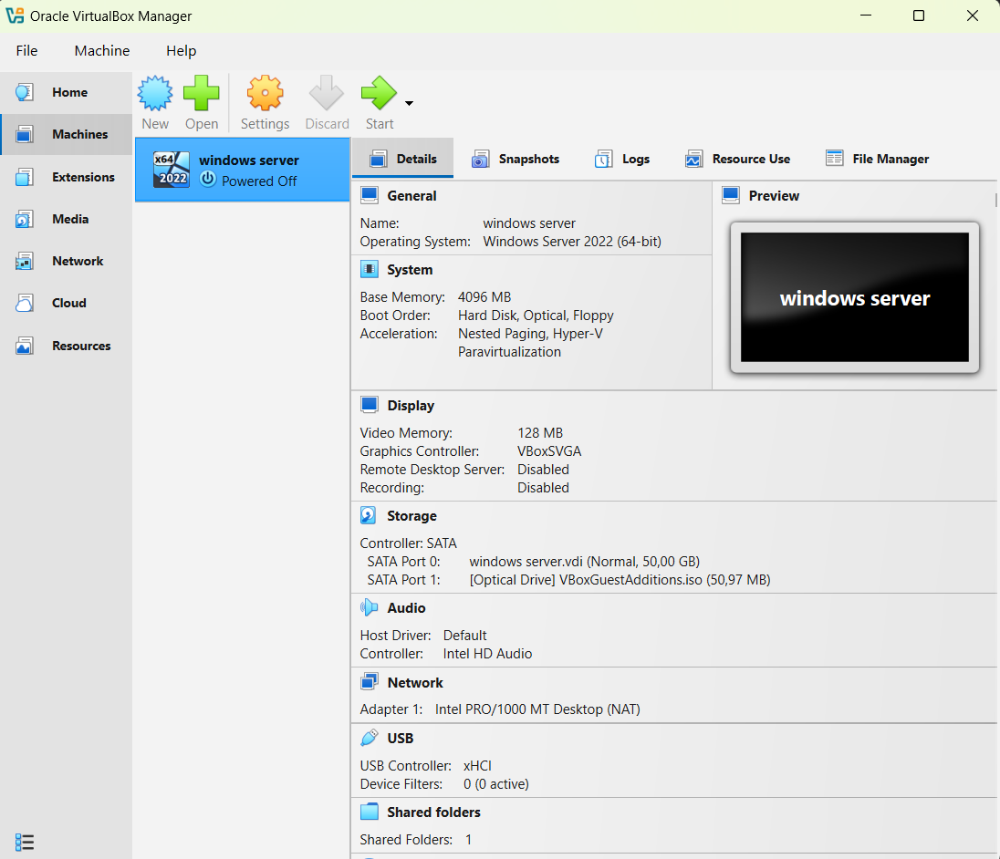

---

## 2. Resources

| Resource | Value | Notes |
|---|---|---|
| vCPUs | 1 | |
| Processing cap | 100% (no cap) | Called Execution Cap in older VirtualBox versions; behaves like a CPU limit (VMware: limit) |
| RAM | 4096 MB | The guest sees only this amount |
| Virtual disk | 50 GB, dynamically allocated | Equivalent of thin provisioning |
| Disk file on host | 14.71 GB (`.vdi`) | Grows as data is written, up to 50 GB (Virtual Media Manager shows virtual 50 GB vs actual 14.71 GB) |
| Reservation | None available | VirtualBox has no memory or CPU reservation |
| Firmware and chipset | BIOS (not UEFI), PIIX3 chipset, no TPM, Secure Boot off | VirtualBox has no equivalent of VMware's hardware version number |
| Disk controller | SATA (AHCI) | |
| Optical drive | `VBoxGuestAdditions.iso` mounted (about 51 MB) | Guest Additions is VirtualBox's equivalent of VMware Tools |

**Notes**
- Because the disk is dynamically allocated, the host drive must keep enough free space for the disk to grow to its full 50 GB. If the host drive fills, the VM can pause or fail (the VirtualBox equivalent of a stunned VM).
- No reservations or shares exist, and the processing cap is at 100%, so nothing limits or guarantees this VM's resources.

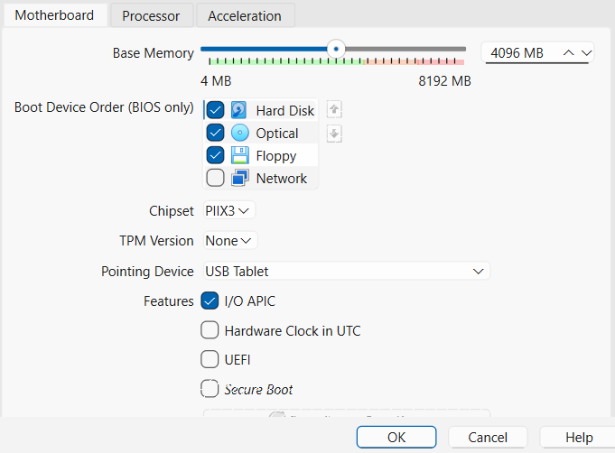
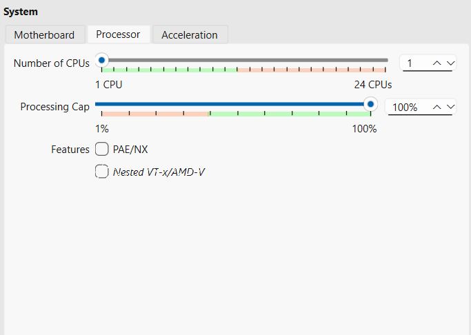
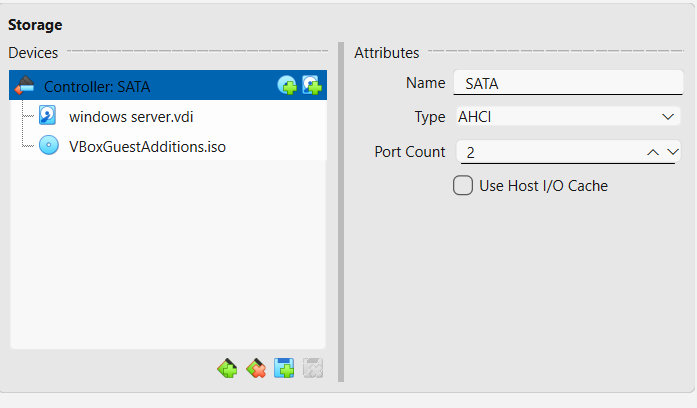
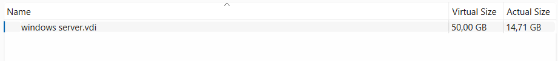

---

## 3. Network

| Item | Value |
|---|---|
| Attachment mode | NAT |
| Adapter type | Intel PRO/1000 MT Desktop (82540EM) |
| Guest IP address | 10.0.2.15 |
| Default gateway | 10.0.2.2 |
| MAC address | 08-00-27-A5-05-97 |
| Addressing | Static (DHCP disabled) |
| DNS servers | 127.0.0.1 and ::1 (the VM itself) |
| Guest hostname | WIN-VIE7I1BPTGR (auto-generated), DNS suffix lab.local |

**Notes**
- In NAT mode the VM can reach the internet, but it is not visible on the local network and other VMs cannot reach it. The host reaches it only through port forwarding.
- The guest is on a different private network from the laptop, which is the NAT-mode pattern.
- Port forwarding rules: None

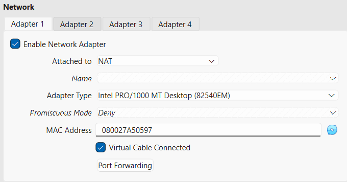
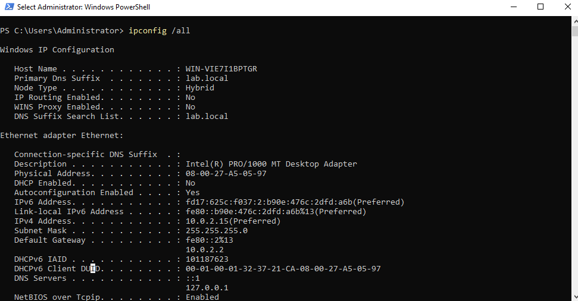

---

## 4. Storage and snapshots

| Item | Value |
|---|---|
| Disk format | VDI (VirtualBox's disk format, equivalent of VMDK) |
| Configuration file | `.vbox` (equivalent of VMware's `.vmx`) |
| Snapshots | 1 |
| Snapshot details | Pre-app, created 2026-11-13 07:52, to keep a working version before installing an application |
| Snapshot folder contents | About 2.1 GB at 2026-11-13 08:34: a 47 MB disk delta and a 2.1 GB saved-state file. The sizes change over time. |

**Notes**
- A snapshot records changes in a separate delta file while the original disk stays untouched (copy-on-write). The delta keeps growing for as long as the snapshot exists, which is why long-lived snapshots are a risk.
- Restoring a snapshot discards changes made since it was taken. Deleting a snapshot keeps the changes and merges the delta into the base disk.
- A snapshot is not a backup. No backup currently of this VM.
- The Snapshots folder holds two kinds of file. The GUID-named `.vdi` is the disk delta (differencing disk): it is small now but keeps growing as the VM runs, while the original `windows server.vdi` stays frozen. The `.sav` file is a saved memory state. Its size reflects how much memory was in use when the state was saved.

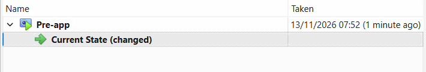
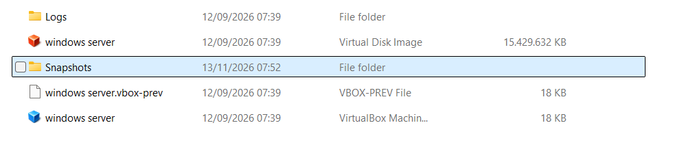
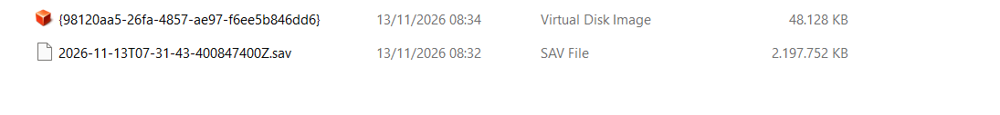

---

## 5. Running services

The VM runs three server roles (from Server Manager): **AD DS**, **DNS** and **File and Storage Services**. The listening ports below show it acting as a domain controller.

| Service or role | Ports | Purpose |
|---|---|---|
| Active Directory Domain Services (`lsass`) | 88, 464 (Kerberos), 389, 636 (LDAP/LDAPS), 3268, 3269 (Global Catalog) | Authentication and the directory for the domain |
| DNS Server (`dns`) | 53 | Name resolution for the domain |
| File and Storage Services (SMB, `System`) | 139, 445 | File sharing; also used by domain controller functions |
| DFS Replication (`dfsrs`) | dynamic | Replicates SYSVOL (domain policies and scripts) |
| Active Directory Web Services | 9389 | Remote management of Active Directory |
| Windows Remote Management (WinRM, `System`) | 5985, 47001 | Remote PowerShell and management |
| RPC (`svchost`) | 135, 593, 49664+ | Windows remote procedure calls used by many services |
| Print Spooler (`spoolsv`) | dynamic | Printing (see risks) |

**Notes**
- Domain name: lab.local
- Remote Desktop (port 3389) is not listening, so the VM can be managed through the hypervisor console or remote PowerShell.
- Server Manager shows one red event on Local Server and All Servers. The event is an unexpected-shutdown entry: the VM was powered off without shutting down cleanly.
- Default Windows services are omitted deliberately; only what the roles expose is listed.

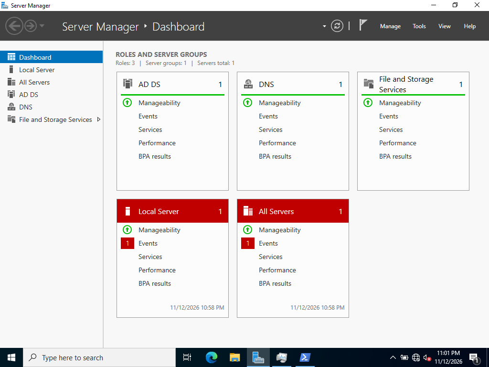
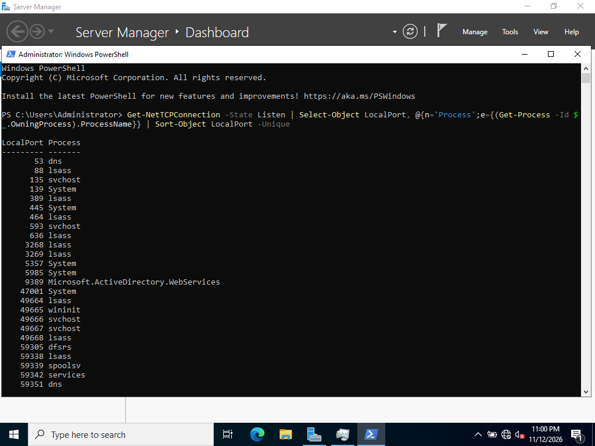

---

## 6. Risks and notes

| Risk | Detail |
|---|---|
| Single host | The VM runs on one laptop. If the laptop fails or loses power, the VM goes down and nothing restarts it elsewhere. VMware's HA and vMotion are not available in VirtualBox. |
| Disk growth | Dynamically allocated disk plus any snapshot growth can fill the host drive. |
| Snapshot age | Created 2026-11-13 07:52, only minutes old when documented. The risk grows the longer it stays, so delete it once the application install is validated. |
| Unclean shutdown on a DC | The event log shows the VM was once powered off without a clean shutdown. A hard power-off can damage the Active Directory database on a domain controller. A snapshot helps, a backup would help more. |
| Shared folder | The VM has one shared folder with the host: the projects folder used for the Active Directory lab. The folder is read-write. Anything in it is reachable from the VM, so keep sensitive files out of that folder, and prefer read-only unless the lab needs to write to it. |
| No backup | Snapshots do not count as backups. |
| NAT limits access | Other machines cannot reach the VM directly; port forwarding or a different network mode would be needed. |
| No resource guarantees | No reservations or shares exist, so the VM competes with everything else on the laptop. |
| Single domain controller | There is one DC, so if it is down nothing can authenticate against the domain, and DNS for the domain goes with it (it runs on the same VM). Production environments run at least two DCs, kept on different hosts with a DRS anti-affinity rule, and give them a high HA restart priority. |
| Restoring snapshots on a DC | Reverting a domain controller to an old snapshot can cause directory replication problems when other DCs exist. Harmless on a lone lab DC, but not something to do on a production one. |
| Print Spooler running | The Print Spooler service is commonly disabled on domain controllers because it is not needed there. Fine in a lab, worth noting for a real server. |

---

## 7. How this maps to VMware

| VirtualBox | VMware equivalent | One difference |
|---|---|---|
| `.vbox` file | `.vmx` file | On ESXi, VM files live in a folder on a datastore and the VM is registered in the host's inventory, managed centrally through vCenter. |
| `.vdi` disk | `.vmdk` disk | VMDK offers thin, thick lazy zeroed and thick eager zeroed provisioning; VirtualBox offers dynamic and fixed. |
| NAT / Bridged / Host-only | vSwitch with port groups (plus VMkernel ports for host traffic) | ESXi has no NAT mode. VM networks are port groups on a vSwitch with VLANs and physical uplinks. Workstation (Type 2) does offer NAT, bridged and host-only. |
| Snapshot | Snapshot | Same copy-on-write idea. In vSphere the deltas are VMDK files on the datastore, large old snapshots trigger warnings, and deleting one runs a consolidation. |
| Processing cap | CPU limit | VMware also has reservations and shares for CPU and memory, and resource pools to group them. |
| Guest Additions | VMware Tools | Both install drivers and integration features inside the guest (VMware Tools includes the VMXNET3 driver). |

**Things VirtualBox cannot show that a real vSphere environment would:** HA restarting the VM after a host failure, vMotion moving it live, DRS balancing it across hosts, shared datastores, and central management through vCenter.
